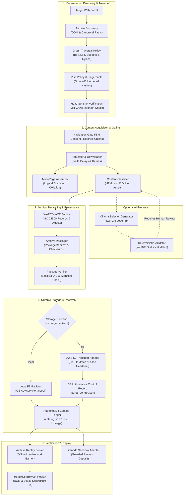

<div align="center">

# CorpusAI

**Reproducible Web-Corpus Archival, Provenance, and Deterministic Crawling**

An open-source research engineering framework for deterministic web discovery, boundary-reconciled incremental crawling, ISO 28500 WARC/WACZ provenance preservation, and offline browser-backed replay.

[](https://www.python.org/downloads/)
[](LICENSE)
[](https://github.com/azharali8/CorpusAi/actions)
[]()
[]()

</div>

---

## Overview

Modern web portals present critical challenges for empirical research, NLP corpus creation, and digital preservation:
- **Unstable Pagination**: Live content publishing shifts paginated indices during crawls, leading to missed head-page articles or duplicate ingest.
- **Taxonomy Cycles & Graph Traversal**: Deeply nested topic, forum, and category structures create unbounded loops without strict visitation budgets.
- **Interleaved Presentation & Content**: Mixed WARC files bundle multi-megabyte presentation assets (CSS, JS, fonts) with primary textual records, complicating downstream linguistic pipelines.
- **Replay Degradation**: Static captures fail when dynamic JavaScript, deferred fonts, and navigation gates cannot be executed or replayed offline under strict network barriers.
- **Distributed State Corruption**: Multi-runner crawls on ephemeral cloud runners risk split-brain updates, lost commits, and corrupt catalog pointers without authoritative concurrency fencing.

**CorpusAI** provides an auditable, deterministic crawling and preservation architecture that tracks explicit provenance, isolates content-bearing records from supporting assets, enforces monotonic fencing generations across local and remote backends, and enables offline browser replay verification with zero live-network fallback.

---

## System Architecture



---

## Key Capabilities

| Capability | Technical Scope & Implementation | Verification Status |
| :--- | :--- | :--- |
| **Deterministic Discovery** | Structural DOM analysis with semantic selectors, path canonicalization, and deduplication | Verified (Live WordPress) |
| **Pagination Stability** | Bounded revisit policies, ordered/unordered SHA-256 fingerprints, and head sentinels | Verified (Synthetic A–N) |
| **Graph Traversal** | Bounded BFS/DFS traversal with domain scoping, cycle detection, and explicit budgets | Verified (Synthetic & Forums) |
| **Gated Navigation** | Finite state-machine handling for consent interstitials, age gates, and redirect chains | Verified (Synthetic) |
| **Multi-Level Forums** | 4-level bbPress traversal (Category -> Pages -> Topics -> Posts) with fragment normalization | Verified (Live bbPress) |
| **Content Separation** | Isolated artifact streams for `content_html`, `content_json`, and supporting `assets` | Verified (Synthetic & Live) |
| **Archival Provenance** | ISO 28500 WARC/WARC.GZ records with custom provenance headers and SHA-256 digests | Verified (Standard WARC/WACZ) |
| **Offline Replay Server** | `ArchiveReplayServer` with index rewriting and strict live-network barriers (HTTP 404) | Verified (14 Tests & Headless) |
| **Daily Orchestration** | CLI runner (`src.corpusai_run`), exponential backoff retries, and bounded HTTP 429 delays | Verified (29 Offline Tests) |
| **Local State Durability** | OS advisory file locking (`msvcrt`/`fcntl`), pre-flight checks, and catalog recovery | Verified (16 Offline Tests) |
| **Repository Deposit** | Zenodo Sandbox adapter with quota checks, draft receipts, and publishing guards | Verified (16 Mocked Tests) |
| **Remote S3 Protocol** | Distributed leases, monotonic fencing generations, CAS (`If-Match`), and byte-level SHA-256 | Verified (35 Mocked Tests) |
| **AI Selector Proposals** | Optional offline selector generation (`qwen2.5-coder:3b`) with deterministic validation | Experimental / Opt-in |

---

## Research & Design Principles

CorpusAI adheres to foundational research principles for reproducible data collection:

1. **Deterministic Core Execution**: Crawl traversal, state transitions, and extraction logic execute deterministically without hidden heuristics or unrecorded branching.
2. **Explicit Cryptographic Provenance**: Every captured URL and record preserves its discovery route, HTTP headers, extraction timestamp, and byte-level SHA-256 digest.
3. **Strict Content vs. Asset Separation**: Primary content-bearing text (`content_html.warc.gz`, `content_json.warc.gz`) is strictly partitioned from presentation assets (`assets.warc.gz`), preventing corpus bloat.
4. **Authoritative Concurrency & Fencing**: Distributed execution coordinates via monotonic fencing generations. Stale runners or expired leases cannot commit baselines or mutate historical catalogs.
5. **Tamper-Evident Package Finalization**: Runs are promoted to baselines only after passing end-to-end checksum verification (`PackageVerifier`). Corrupt uploads are non-destructively quarantined.
6. **Air-Gapped Replay Validation**: Replay fidelity is evaluated under strict network isolation (`--proxy-server=http://127.0.0.1:9`, `--host-rules`), prohibiting live-network fallbacks.
7. **The AI Safety Boundary**:
   > *AI proposes. Deterministic systems validate. Human approval remains explicit.*
   Local LLM proposals never deploy autonomously to production selector configs.

---

## Project Structure

```text
CorpusAI/
├── .github/
│   └── workflows/
│       ├── tests.yml                  # Offline CI test suite (Python 3.11)
│       └── daily_run.yml              # Daily archival orchestration workflow (manual dispatch)
├── config/                            # Extraction schemas and selector rules
├── data/                              # Synthetic HTML benchmarks and ground-truth fixtures
├── docs/                              # Architecture specifications and technical designs
│   ├── archive_storage_design.md      # Storage layouts and packaging specification
│   ├── phase8_daily_run.md            # Daily runner lifecycle, exit codes, and retries
│   ├── phase9a_zenodo_deposit.md      # Zenodo Sandbox adapter and receipt state machine
│   └── phase9b_durable_state.md       # Advisory locking, catalog reconciliation, and retention
├── research/                          # Empirical benchmarks and real-world validation
│   ├── archiving/                     # Mixed-content WARC analysis experiments
│   ├── crawling/                      # Pagination mutation and graph traversal benchmarks
│   └── real_world/                    # Real-world validation (WordPress News & Support Forums)
├── results/                           # Evaluation reports, WACZ archives, and replay diffs
├── src/                               # Core CorpusAI framework
│   ├── archive_catalog.py             # Run catalog ledger and baseline pointers
│   ├── archive_graph_policy.py        # Graph exploration and cycle detection
│   ├── archive_package.py             # Packaging, verification, and manifest generation
│   ├── archive_page_discovery.py      # DOM article link extraction
│   ├── archive_run.py                 # Immutable run metadata model
│   ├── archive_visit_policy.py        # Fingerprinting and revisit policies
│   ├── catalog_recovery.py            # Orphaned package reconciliation and audit
│   ├── corpusai_run.py                # Operational CLI entrypoint and lifecycle coordinator
│   ├── deposit_metadata.py            # Research corpus deposit schema
│   ├── downloader.py                  # Polite fetcher and asset harvester
│   ├── head_verification.py           # Sentinel polling and boundary reconciliation
│   ├── incremental_archive_policy.py  # Incremental crawl coordinator and retry policy
│   ├── multipage_article_policy.py    # Multi-component logical document assembly
│   ├── navigation_gate_policy.py      # Navigation gate finite state machine
│   ├── portal_state.py                # Serialized portal crawl state
│   ├── remote_storage_contract.py     # Authoritative remote storage protocol specification
│   ├── replay_server.py               # Air-gapped offline HTTP archive replay server
│   ├── s3_storage_backend.py          # AWS S3 transport adapter with CAS and lease heartbeats
│   ├── storage_backend.py             # Local filesystem backend and OS advisory locking
│   ├── warc_utils.py                  # ISO 28500 WARC creation and MIME classification
│   └── zenodo_deposit.py              # Zenodo Sandbox repository deposit client
├── tests/                             # Comprehensive offline test suite (355 tests)
│   ├── fixtures/                      # Synthetic WARC and fixture generators
│   ├── integration/                   # Opt-in live integration tests (S3 / remote)
│   ├── test_phase8_runner.py          # Daily runner lifecycle and retry tests
│   ├── test_phase9cb_s3_adapter.py    # S3 transport adapter and CAS unit tests
│   └── ...                            # Component unit and benchmark suites
├── pyproject.toml                     # Project build and tool configuration
└── requirements.txt                   # Production and testing dependencies
```

---

## Installation & Setup

### Prerequisites
- **Python**: Version `3.11` or higher
- **Browser (Optional for Replay QA)**: Google Chrome, Chromium, or Microsoft Edge
- **Local LLM (Optional for AI Selector Proposals)**: [Ollama](https://ollama.com/) with `qwen2.5-coder:3b`

### 1. Clone & Environment Setup

```bash
git clone https://github.com/azharali8/CorpusAi.git
cd CorpusAi

# Create virtual environment
python -m venv .venv

# Activate environment
# On Linux / macOS:
source .venv/bin/activate
# On Windows (PowerShell):
.venv\Scripts\Activate.ps1
# On Windows (cmd):
.venv\Scripts\activate.bat

# Install dependencies
pip install --upgrade pip
pip install -r requirements.txt
```

---

## Usage Guide

### 1. Daily Archival Runner (`src.corpusai_run`)

The CLI runner coordinates the end-to-end lifecycle: lock acquisition, state hydration, polite crawling, package verification, catalog registration, and lease release.

```bash
# Baseline crawl on local storage (default)
python -m src.corpusai_run --portal wordpress-news --mode baseline

# Incremental crawl reusing prior baseline
python -m src.corpusai_run --portal wordpress-news --mode incremental

# Dry-run validation (resolves configuration and robots.txt without writing)
python -m src.corpusai_run --portal wordpress-news --mode incremental --dry-run
```

#### Deterministic Exit Codes
| Exit Code | Semantic Meaning | Description |
| :---: | :--- | :--- |
| `0` | `SUCCESS` | Crawl converged, package created, and verification succeeded |
| `1` | `FETCH_FAILED` | Unrecoverable fetch error or exhausted request retries |
| `2` | `INVALID_ARGS` | Invalid CLI arguments or unrecognized portal identifier |
| `3` | `ROBOTS_DISALLOWED` | Prohibited by portal `robots.txt` policy |
| `4` | `NO_BASELINE` | Incremental crawl attempted without an established baseline |
| `5` | `VERIFICATION_FAILED` | Package manifest or SHA-256 byte check failed locally |
| `6` | `BUDGET_EXHAUSTED` | Configured request or page budget reached before convergence |
| `7` | `ANOMALY_DETECTED` | Structural anomaly detected (empty head, pagination shift) |
| `8` | `LOCK_CONTENTION` | Another runner actively holds the local OS portal advisory lock |
| `9` | `REMOTE_STORAGE_FAILED`| S3 remote artifact upload, byte verification, or CAS commit failed |
| `10` | `REMOTE_LEASE_LOST` | S3 portal lease expired or was preempted by a newer generation |

---

### 2. AWS S3 Remote Storage Adapter

To persist state across ephemeral CI runners or distributed instances, configure the S3 backend:

```bash
# Run baseline crawl backed by S3 durable storage
python -m src.corpusai_run --portal wordpress-news --mode baseline \
  --storage-backend s3 \
  --s3-bucket my-corpusai-archive \
  --s3-prefix corpusai/prod

# Run incremental crawl hydrating state from S3
python -m src.corpusai_run --portal wordpress-news --mode incremental \
  --storage-backend s3 \
  --s3-bucket my-corpusai-archive \
  --s3-prefix corpusai/prod
```

#### Protocol Guarantees
- **Conditional CAS Writes**: Lease updates and baseline commits use `If-None-Match: *` (creation) and `If-Match: "<etag>"` (mutation). `HTTP 412` triggers atomic conflict rejection.
- **Heartbeat Coordination**: Background thread [`S3LeaseHeartbeat`](src/s3_storage_backend.py) periodically renews lease TTLs and synchronizes ETags.
- **Byte-Level Verification**: Uploaded artifacts are verified by streaming raw bytes back and validating against `checksums.sha256`. S3-provided MD5 ETags are never trusted as proof of integrity.
- **Non-Destructive Quarantine**: Corrupted or incomplete uploads write diagnostic records to `quarantine/` without deleting package data.

```text
s3://<bucket>/<prefix>/
├── state/<portal_id>/
│   ├── portal_control.json        # Sole authoritative record (fencing / lease / baseline)
│   ├── catalog.json               # Projected history ledger
│   ├── deposit_registry.json      # Repository deposit receipts
│   └── quarantine/                # Failed upload descriptors
└── packages/<portal_id>/runs/<run_id>/
    ├── manifest.json              # Run manifest
    ├── checksums.sha256           # Authoritative artifact digests
    ├── portal_state.json          # Serialized portal state
    ├── run_summary.json           # Outcome summary and metrics
    ├── run.log                    # Full execution diagnostics
    └── content_html.warc.gz       # Preserved WARC records
```

---

### 3. Air-Gapped Offline Browser Replay

CorpusAI includes a native replay engine for browser rendering without external network access:

```bash
# Execute local replay server and headless browser validation
python research/real_world/wordpress/run_replay_e2e_validation.py
```

- Serves content from index-mapped WARC/WACZ files via local loopback.
- Binds Chrome/Chromium with strict proxy isolation (`--proxy-server=http://127.0.0.1:9`, `--host-rules`).
- External calls return `HTTP 404` with header `X-CorpusAI-Replay-Error: NOT_FOUND_NO_LIVE_FALLBACK`.
- Generates screenshot diffs (`results/wordpress_validation/replay_verification/`).

---

### 4. Synthetic Stability Benchmarks

```bash
# Unstable pagination mutation benchmark
python research/crawling/experiments/run_stability_experiment.py

# Head-page verification and insertion detection
python research/crawling/experiments/run_head_verification_experiment.py

# Multi-level taxonomy graph traversal benchmark
python research/crawling/experiments/run_multilevel_experiment.py

# Navigation gate and multi-page assembly simulation
python research/crawling/experiments/run_gated_navigation_experiment.py
```

---

## Testing & Verification

All standard unit and protocol tests execute completely **offline** using deterministic synthetic fixtures.

```bash
# Run the full offline test suite
pytest -v
```

### Verification Status
- **Linux CI (`.github/workflows/tests.yml`)**: **355 tests passing** (verified on commit `c401c5a` and `077b8f3`, Python 3.11).
- **Synthetic Fixtures**: Clean checkouts automatically generate required test WARCs (`synthetic_portal.warc`, `mixed_content_test.warc`) via `conftest.py` hooks without storing binary blobs in Git.
- **Opt-in Live S3 Integration**: Three opt-in live S3 integration tests in `tests/integration/test_live_s3_storage.py` test real S3 bucket APIs. These are **strictly opt-in**, unverified against production, and safely skipped in standard CI:
  ```bash
  export CORPUSAI_STORAGE_LIVE_TEST=1
  export CORPUSAI_S3_BUCKET=my-test-bucket
  export CORPUSAI_S3_PREFIX=corpusai-live-test
  python -m pytest tests/integration/test_live_s3_storage.py -v
  ```

---

## Current Development Status

```text
[✓] Implemented & Verified in CI     [~] Implemented & Tested with Mocks     [ ] Gated / Future Milestone
```

- **`[✓]` Core Deterministic Crawler**: DOM article discovery, pagination policies, and graph traversal.
- **`[✓]` Provenance Engine**: ISO 28500 WARC/WACZ generator and MIME content separator.
- **`[✓]` Offline Replay Server**: Native loopback replay with browser network barrier and visual QA.
- **`[✓]` Multi-Level Forum Crawling**: 4-level bbPress traversal with reply fragment normalization.
- **`[✓]` Daily Run Orchestration**: Production CLI runner with exponential retries and deterministic exit codes.
- **`[✓]` Durable Local Storage**: OS advisory file locking, catalog recovery, and package verification.
- **`[~]` S3 Remote Storage Adapter**: Fully implemented with CAS, lease heartbeats, and recovery (35/35 offline mock tests passing; live S3 integration pending real AWS environment).
- **`[~]` Zenodo Sandbox Deposit**: Adapter implemented with quota enforcement and receipt registry (16/16 offline mock tests passing; production deposit disabled).
- **`[ ]` Unattended Scheduled Crawling**: Cron triggers remain gated until persistent storage credentials are configured.
- **`[ ]` Public Repository Deposits**: Public publishing strictly disabled by default (`allow_publish=False`).

---

## Limitations & Safety Boundaries

- **Experimental Research Framework**: CorpusAI is an experimental research prototype evaluating algorithmic crawler policies, not an enterprise distributed crawler.
- **Bounded Real-World Evaluations**: Real-world validation has targeted bounded subsets of WordPress News (`/news/all-posts/`) and WordPress Support Forums. Full portal coverage was intentionally not attempted (`full_portal_coverage = false`).
- **Access Restrictions**: CorpusAI does not bypass CAPTCHAs, paywalls, or authentication barriers. Interstitial handling is strictly limited to simulated transparent consent gates.
- **Polite Execution**: Complies with `robots.txt`, identifies via an academic research User-Agent, and enforces polite request delays (1.5–2.0s).
- **Storage Gate**: Automated scheduled crawls on GitHub Actions are intentionally commented out; ephemeral CI runner disks discard uncommitted crawls upon workflow completion.

---

## Roadmap

1. **Phase 9C-C: Live Storage & Recovery Validation**: End-to-end verification against real S3/R2 endpoints and automated fresh-runner recovery drills.
2. **Scheduled Cloud Workflows**: Enabling automated cron execution once durable remote storage secrets are established.
3. **Automated Replay Regression Testing**: Automated perceptual visual diffing against gold standard renders across portal redesigns.
4. **TEI/XML Downstream Transformations**: Export pipelines transforming preserved WARC payloads into standardized TEI/XML formats for NLP research.

---

## License & Attribution

CorpusAI source code and documentation are licensed under the **[Apache License 2.0](LICENSE)**.

### Third-Party Materials
- Archived web content, HTML, images, CSS, JavaScript, and fonts captured during experiments remain the intellectual property of their respective copyright holders.
- Research captures are conducted under academic fair use for corpus construction and digital preservation evaluation.
- External software components and attributions are documented in [`THIRD_PARTY_NOTICES.md`](THIRD_PARTY_NOTICES.md).
