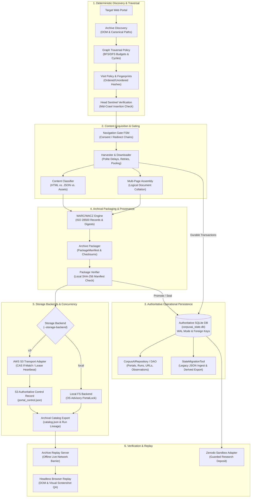

<div align="center">

# CorpusAI

**Reproducible Web-Corpus Archival, Provenance, and Deterministic Crawling**

An open-source research engineering framework for deterministic web discovery, boundary-reconciled incremental crawling, ISO 28500 WARC provenance preservation with WACZ replay packaging, authoritative SQLite persistence, and offline browser-backed replay.

[](https://www.python.org/downloads/)
[](LICENSE)
[](https://github.com/azharali8/CorpusAi/actions)
[]()

</div>

---

## 1. Project Overview

Modern web portals present critical challenges for empirical research, NLP corpus creation, and digital preservation:
- **Unstable Pagination**: Live content publishing shifts paginated indices during crawls, leading to missed head-page articles or duplicate ingest.
- **Taxonomy Cycles & Graph Traversal**: Deeply nested topic, forum, and category structures create unbounded loops without strict visitation budgets.
- **Interleaved Presentation & Content**: Mixed WARC files bundle multi-megabyte presentation assets (CSS, JS, fonts) with primary textual records, complicating downstream linguistic pipelines.
- **Replay Degradation**: Static captures fail when dynamic JavaScript, deferred fonts, and navigation gates cannot be executed or replayed offline under strict network barriers.
- **Distributed State Corruption & Inconsistent Concurrency**: Multi-runner crawls or crash interruptions on ephemeral runners risk split-brain updates, lost commits, and corrupt catalog pointers without authoritative concurrency fencing and transactional persistence.

**CorpusAI** provides an auditable, deterministic crawling and preservation architecture that:
- Tracks explicit cryptographic provenance for every harvested URL.
- Partitions content-bearing records from supporting presentation assets into separate WARC streams.
- Manages operational crawler lifecycle, URL frontiers, and deposit status within an **authoritative transactional SQLite storage engine** enforcing WAL mode and strict relational foreign keys.
- Enforces monotonic fencing generations and advisory portal locking across local and remote storage backends.
- Enables offline browser replay verification with zero live-network fallback.

---

## 2. Key Capabilities

| Capability | Technical Scope & Implementation | Verification Status |
| :--- | :--- | :--- |
| **Deterministic Discovery** | Structural DOM analysis with semantic selectors, path canonicalization, and deduplication (`src/archive_page_discovery.py`, `src/extractor.py`) | Production-Supported |
| **Pagination Stability** | Bounded revisit policies, ordered/unordered SHA-256 fingerprints, and head sentinels (`src/incremental_archive_policy.py`) | Production-Supported |
| **Graph Traversal** | Bounded BFS/DFS traversal with domain scoping, cycle detection, and explicit budgets (`src/archive_graph_policy.py`) | Production-Supported |
| **Gated Navigation** | Finite state-machine handling for consent interstitials, age gates, and redirect chains (`src/navigation_gate_policy.py`) | Production-Supported |
| **Multi-Level Forums** | 4-level bbPress traversal (Category -> Pages -> Topics -> Posts) with fragment normalization | Production-Supported |
| **Content Separation** | Isolated artifact streams for `content_html`, `content_json`, and supporting `assets` (`src/downloader.py`, `src/warc_utils.py`) | Production-Supported |
| **Archival Provenance** | ISO 28500 WARC/WARC.GZ records with custom provenance headers and SHA-256 digests (`src/warc_utils.py`) | Production-Supported |
| **Shared Crypto & Manifest** | Streaming 64KB chunked SHA-256/MD5 hashing, chunk-parallel `MultiThreadedMurmurHash3`, and canonical manifest generation (`src/utils/crypto.py`, `src/utils/manifest.py`) | Production-Supported |
| **Strict Path Containment** | Verified `pathlib.Path` architecture with root-containment validation and path traversal prevention (`src/utils/paths.py`) | Production-Supported |
| **Authoritative SQLite Persistence** | Single source of truth for portals, runs, page observations, content URLs, packages, checkpoints, outbox events, and deposit receipts (`src/storage/`) | Production-Supported |
| **Crash & Interrupted Recovery** | Durable transaction boundaries during crawl loops; automated promotion of valid `FINALIZING` packages via `PackageVerifier`; graceful `INTERRUPTED` state handling | Production-Supported |
| **Offline Replay Server** | `ArchiveReplayServer` with index rewriting and strict live-network barriers (`src/replay_server.py`) | Production-Supported |
| **Daily Orchestration** | CLI runner (`src/corpusai_run.py`), exponential backoff retries, request budgets, and deterministic exit codes | Production-Supported |
| **Local State Durability** | OS advisory file locking (`msvcrt`/`fcntl`), pre-flight checks, and catalog recovery (`src/catalog_recovery.py`) | Production-Supported |
| **Repository Deposit** | Zenodo Sandbox adapter with quota checks, draft receipts, and publishing guards (`src/zenodo_deposit.py`, `src/zenodo_stuff/`) | Supported with Mocks |
| **Remote S3 Protocol** | Distributed leases, monotonic fencing generations, CAS (`If-Match`), and byte-level SHA-256 (`src/s3_storage_backend.py`) | Supported with Mocks |
| **AI Selector Proposals** | Optional offline selector proposal generator (`qwen2.5-coder:3b`) with deterministic validation (`src/rule_generator.py`) | Experimental / Opt-in |

---

## 3. System Architecture



### Separation of Responsibilities
1. **SQLite Operational State**: Single source of truth for mutable state (active portals, running/finalizing crawl runs, discovered content URLs, page observations, article extraction statuses, outbox events, and deposit receipts).
2. **Filesystem Archival Content**: Read-only, content-addressed, tamper-evident packages containing WARC streams, screenshot captures, and SHA-256 checksums.
3. **JSON Compatibility & Archival Metadata**: Non-authoritative derived exports (`catalog.json`, `portal_state.json`, `deposit_registry.json`) generated on demand for legacy tool interoperability and package self-containment.
4. **External Repositories**: Ephemeral or sandbox staging with Zenodo / S3 guarded by strict credentials and CAS versioning.

---

## 4. SQLite Persistence & Schema Architecture

CorpusAI uses SQLite (`corpusai_state.db`) in WAL (Write-Ahead Logging) mode with strict composite foreign-key enforcement and custom integrity triggers.

### Database Location
The operational database is located inside the results directory for the crawl run:
```text
<results_base_dir>/storage/corpusai_state.db
```
For default WordPress News runs, this resolves to `results/wordpress_validation/phase6b/storage/corpusai_state.db`.

### Core Database Tables
Inspected from `src/storage/schema.py`:
- `portals`: Registered target web portals, base URLs, parser specifications, and pointer to `latest_successful_run_id`.
- `runs`: Crawl execution records, timestamps, execution mode (`baseline`/`incremental`), terminal status (`PENDING`, `RUNNING`, `FINALIZING`, `CONVERGED`, `INTERRUPTED`, `FAILED`, `BUDGET_EXHAUSTED`, `MANUAL_REVIEW_REQUIRED`), and full counters.
- `discovered_urls`: Canonical content URL index, discovery run ID, first/last seen timestamps, and capture statuses.
- `url_observations`: Historical log of every time a URL is observed across crawl runs.
- `archive_page_observations`: Paginated archive page listings, page numbers, observation timestamps, and ordered/unordered fingerprints.
- `portal_states`: Historical serialized snapshot headers and source manifests.
- `run_checkpoints`: Durable crawl-loop checkpoints and system-level migration completion markers (`run_id='__system__'`).
- `article_states`: Extracted article metadata, publication dates, titles, content SHA-256 digests, and WARC record references.
- `packages`: Finalized archival packages, sealing timestamps, package paths, and manifest digests.
- `deposit_records` & `deposit_artifacts`: Zenodo deposit receipts, DOIs, deposition IDs, remote file IDs, and upload statuses.
- `outbox_events`: Transactional outbox table supporting guaranteed at-least-once asynchronous event delivery with rotating lease tokens.

### Schema Integrity & Triggers
- **Pointer Validation Trigger** (`trg_portals_latest_run_validate_insert`, `trg_portals_latest_run_validate_update`): Uses `NOT EXISTS` subqueries to guarantee `latest_successful_run_id` points only to an existing run belonging to the same portal with an approved successful status (`CONVERGED`, `COMPLETED`, `PILOT_SCOPE_CONVERGED`, `MULTIPAGE_PILOT_COMPLETE`). Nonexistent, cross-portal, failed, or interrupted runs are rejected with `IntegrityError`.
- **Status Demotion Guard** (`trg_runs_prevent_successful_status_invalidation`): Prevents changing the status of a referenced run away from successful while it is pointed to by a portal.

### One-Time Legacy Migration & Idempotency
- On startup, `src/corpusai_run.py` checks `state_repo.is_portal_migrated(portal_id)`.
- If unmigrated and no runs exist, `StateMigrationTool.import_catalog_json()` imports historical runs atomically, marks `legacy_migration_complete` under `run_checkpoints`, and updates SQLite.
- Brand new portals register directly in SQLite with `legacy_imported=True`.
- Subsequent runs never re-ingest or overwrite from legacy JSON.

### Crash & Incomplete Run Recovery
On startup, CorpusAI reconciles incomplete runs:
- **`RUNNING` runs**: Incomplete crawls are marked `INTERRUPTED`. Intermediate URL discovery and page observations remain safely preserved in SQLite for subsequent recover-and-restart.
- **`FINALIZING` runs**: If interrupted during packaging, `state_repo.recover_finalizing_run()` validates the package directory using `PackageVerifier`. If valid, the run is promoted to `CONVERGED` and the portal pointer updated without discarding crawled data. If invalid or missing, it transitions to `FAILED` or `MANUAL_REVIEW_REQUIRED`.

---

## 5. Installation & Environment Setup

### Prerequisites
- **Python**: Version `3.11` or higher (CI runs on Python 3.11, 3.12, 3.13; tested on Windows Python 3.13).
- **PowerShell**: Windows PowerShell 5.1 or PowerShell Core 7+.
- **Browser (Optional for Replay QA)**: Google Chrome, Chromium, or Microsoft Edge.
- **Local LLM (Optional for AI Selector Proposals)**: [Ollama](https://ollama.com/) with `qwen2.5-coder:3b`.

### Step-by-Step Installation (Windows PowerShell)

```powershell
# 1. Clone repository
git clone https://github.com/azharali8/CorpusAi.git
cd CorpusAi

# 2. Create and activate Python virtual environment
python -m venv .venv
.\.venv\Scripts\Activate.ps1

# 3. Upgrade pip and install core dependencies
python -m pip install --upgrade pip
pip install -r requirements.txt

# 4. (Optional) Install screenshot comparison and test extras
pip install -e ".[screenshots,test]"
```

---

## 6. Running CorpusAI

### CLI Arguments & Options (`src.corpusai_run`)

```powershell
python -m src.corpusai_run --help
```

| Argument | Type | Default | Description |
| :--- | :--- | :--- | :--- |
| `--portal` | string | *required* | Target portal identifier (e.g., `wordpress-news`). |
| `--mode` | `baseline` \| `incremental` | *required* | Crawl execution mode. |
| `--results-dir` | string | `None` | Optional override for the results base directory. |
| `--dry-run` | flag | `False` | Parse args and resolve config without making HTTP requests or writing files. |
| `--log-level` | string | `INFO` | Console logging level (`DEBUG`, `INFO`, `WARNING`, `ERROR`). |
| `--reconcile-catalog` | flag | `False` | Audit and reconcile catalog with verified packages before run. |
| `--cleanup-staging` | flag | `False` | Execute conservative retention cleanup on raw staging runs. |
| `--storage-backend` | `local` \| `s3` | `local` | Remote storage backend. Use `s3` for AWS S3 durable state. |
| `--s3-bucket` | string | `None` | S3 bucket name. Required when `--storage-backend=s3`. |
| `--s3-prefix` | string | `""` | S3 key prefix for all objects. |
| `--runner-id` | string | auto | Unique runner identifier for lease tracking. |

### Command Examples

```powershell
# Execute a dry-run to test configuration and robots.txt resolution
python -m src.corpusai_run --portal wordpress-news --mode baseline --dry-run

# Run a baseline crawl on local storage
python -m src.corpusai_run --portal wordpress-news --mode baseline

# Run an incremental crawl building upon prior baseline
python -m src.corpusai_run --portal wordpress-news --mode incremental

# Run an incremental crawl with debug logging and catalog audit
python -m src.corpusai_run --portal wordpress-news --mode incremental --log-level DEBUG --reconcile-catalog
```

---

## 7. Archival Package Structure & Verification

Finalized runs produce self-contained, tamper-evident packages verified independently of SQLite:

```text
results/wordpress_validation/phase6b/packages/wordpress-news/runs/<run_id>/
├── manifest.json              # Package manifest (portal_id, run_id, timestamps, record counts)
├── checksums.sha256           # Authoritative SHA-256 digests for all package files
├── environment.json           # Python runtime, OS, hardware, and dependency metadata
├── portal_state.json          # Complete serialized crawl state snapshot
├── deposit_metadata.json      # (Optional) Zenodo research corpus deposit metadata
├── run.log                    # Execution log diagnostics
└── content/
    ├── content_html.warc.gz   # Primary extracted textual content (ISO 28500)
    └── assets.warc.gz         # Supporting presentation assets (CSS/JS/images)
```

### Standalone Package Verification
Packages can be independently verified without a database connection using `PackageVerifier`:

```python
from pathlib import Path
from src.archive_package import PackageVerifier

package_dir = Path("results/wordpress_validation/phase6b/packages/wordpress-news/runs/run-100")
result = PackageVerifier.verify(package_dir)
print(f"Valid: {result.is_valid}, Errors: {result.errors}")
```

---

## 8. Testing & Verification

The test suite covers unit logic, storage models, schema triggers, crypto hashing, and runner orchestration.

```powershell
# Run the complete test suite
python -m pytest tests/

# Run focused SQLite storage and trigger verification tests
python -m pytest tests/test_sqlite_storage.py -v

# Run focused repository, migration, and recovery tests
python -m pytest tests/test_sqlite_repository.py tests/test_phase9b_storage_recovery.py -v

# Run streaming crypto and multi-threaded hasher tests
python -m pytest tests/test_crypto_utils.py -v

# Run strict pathlib path utility tests
python -m pytest tests/test_path_utils.py -v
```

### Environment Notes & Known Test Limits
- **Isolated Storage Suite Execution**: The SQLite storage, repository, and recovery test suites execute reliably in isolated environments.
- **Loopback Socket Requirements**: Tests exercising live loopback servers (`test_controlled_incremental_crawler.py`, `test_browser_replay.py`, and `test_controlled_crawl_to_archival_package_integration`) bind local TCP ports and require standard socket access permissions (`[WinError 10013]` occurs in restricted execution sandboxes).
- **Opt-in Live Integration**: S3 live cloud tests (`tests/integration/test_live_s3_storage.py`) require live AWS credentials and are skipped by default.

---

## 9. Research & Contribution Notes

CorpusAI adheres to strict research design principles:
1. **Deterministic Core Execution**: Crawl traversal, state transitions, and extraction logic execute deterministically without hidden heuristics.
2. **Explicit Cryptographic Provenance**: Every captured URL preserves its discovery route, HTTP headers, extraction timestamp, and byte-level SHA-256 digest.
3. **Strict Content vs. Asset Separation**: Content-bearing text (`content_html.warc.gz`) is strictly separated from presentation assets (`assets.warc.gz`).
4. **The AI Safety Boundary**:
   > *AI proposes. Deterministic systems validate. Human approval remains explicit.*
   Local LLM proposals (`src/rule_generator.py`) never deploy autonomously to production selector configurations.

---

## 10. Known Limitations

- **Research Prototype Scope**: Designed for bounded, verifiable digital corpus construction rather than unbounded web-scale search crawling.
- **Access Restrictions**: CorpusAI does not bypass CAPTCHAs, paywalls, or bot gates.
- **Live Network Replay**: Offline replay strictly denies live network egress (HTTP 404); web pages requiring third-party runtime APIs not captured in WARC will render without them.
- **Production Public Deposits**: Public publishing to Zenodo is disabled by default (`allow_publish=False`) to avoid accidental sandbox-to-production leakages.

---

## License & Attribution

CorpusAI source code and documentation are licensed under the **[Apache License 2.0](LICENSE)**.
External software components and attributions are documented in [`THIRD_PARTY_NOTICES.md`](THIRD_PARTY_NOTICES.md).
